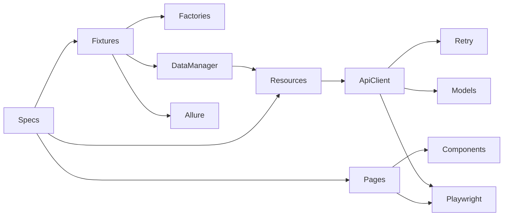

# Toolshop QA Automation Portfolio

Production-style **Python + Playwright + pytest** automation for the Toolshop customer journey. The project demonstrates typed API clients, Pydantic contracts, reusable UI components, API-driven test data, controlled retries, Allure diagnostics, Docker execution, and GitHub Actions.

## Application under test

[Practice Software Testing](https://practicesoftwaretesting.com/) is an Angular storefront with a Laravel REST API. This project targets Sprint 5 and runs it locally:

- UI: `http://localhost:4200`
- API and Swagger: `http://localhost:8091/api/documentation`

The upstream application is cloned at a pinned commit into ignored `.runtime/` storage. Its source is **not vendored**. See the [upstream repository and license](https://github.com/testsmith-io/practice-software-testing): this portfolio contains independent tests only.

## What is covered

| Suite | Scenarios |
|---|---|
| API | Authentication, registration validation, typed catalog contracts, pagination, search, carts, favorites, authorization |
| UI | Catalog and product details, search, registration, login/logout, invalid login, cart totals, favorites, checkout validation |
| E2E | UI login through purchase and API verification; API-prepared user/cart through UI checkout |
| Self | Retry behavior, sensitive-data redaction, factory uniqueness |

There are **30 collected tests**: 13 API, 10 UI, 2 E2E, and 5 framework self-tests. Chromium is the supported browser.

## Design patterns

| Pattern | Implementation |
|---|---|
| Page Object | `src/toolshop/ui/pages/` exposes business actions and web-first locators |
| Component Object | Header/navigation, product card, pagination, and toast components in `src/toolshop/ui/components/` |
| API Client Wrapper | `ApiClient` wraps Playwright `APIRequestContext`; resource clients hide URLs and payloads |
| Typed models | Pydantic DTOs validate requests/responses while allowing additive response fields |
| Factory | `UserFactory` and `CheckoutDataFactory` generate unique, valid test data |
| Fixture preconditions | `registered_user`, `product`, `cart`, and `page_with_cart` build isolated state through API |
| Cleanup | `TestDataManager` tracks users, carts, and favorites and removes them after each test |
| Controlled retry | Transient GET/network retry in `ApiClient`; one pytest rerun only in CI |
| test.step equivalent | `with allure.step(...)` in specs and typed `@step(...)` on framework actions |



## Prerequisites

- Python 3.12 or 3.13
- [uv](https://docs.astral.sh/uv/) 0.13.7 or compatible
- Docker Desktop or Docker Engine with Compose
- Optional: [Allure CLI](https://allurereport.org/docs/install/) to render local HTML
- Optional: [GitHub CLI](https://cli.github.com/) for workflow operations

## Setup

```bash
cp .env.example .env
uv sync --locked
uv run playwright install chromium
uv run python scripts/app.py start
```

On Windows PowerShell, use `Copy-Item .env.example .env`. The admin credentials in `.env.example` belong only to the seeded local application and are used to delete generated users. Do not put real credentials into `.env.example`.

The application script pins the upstream revision. Useful commands:

```bash
uv run python scripts/app.py status
uv run python scripts/app.py logs
uv run python scripts/app.py stop
uv run python scripts/app.py reset  # destroys this application's local Docker volumes
```

## Run tests

```bash
# Everything, including self-tests
uv run pytest

# Fast independent framework checks
uv run pytest -m self

# Application suites
uv run pytest -m api
uv run pytest -m ui
uv run pytest -m e2e
uv run pytest -m "smoke and not self"

# Parallel execution; reruns are intentionally not enabled locally
uv run pytest -m "not self" -n 2
```

Set `TOOLSHOP_HEADLESS=false` in `.env` for headed local debugging. Test-level reruns are not a local default: a failure should be investigated rather than hidden.

## Allure and diagnostics

Every run writes results to `artifacts/allure-results/`.

```bash
allure generate artifacts/allure-results --clean -o artifacts/allure-report
allure open artifacts/allure-report
```

Failed UI tests include a screenshot, video, trace ZIP, last URL, and browser errors. API requests/responses are attached with passwords and tokens recursively redacted. Traces can also be inspected with:

```bash
uv run playwright show-trace artifacts/diagnostics/<test-name>/trace.zip
```

## Docker test runner

Start the application first, then build and run the independent test container:

```bash
docker compose -f compose.tests.yml build
docker compose -f compose.tests.yml run --rm tests -m api
docker compose -f compose.tests.yml run --rm tests -m ui
docker compose -f compose.tests.yml run --rm tests -m e2e
```

The runner uses Playwright image `v1.64.1-noble`, matching `uv.lock`. Results are mounted into `artifacts/`. `host.docker.internal` is configured for both Docker Desktop and Linux CI. An `alpine/socat` sidecar shares its network namespace with the test runner so Angular's `localhost:8091` API calls reach the host application correctly.

```bash
docker compose -f compose.tests.yml down --remove-orphans
```

## Quality gates

```bash
uv run ruff format --check .
uv run ruff check .
uv run mypy src tests scripts
uv run pytest -m self
uv run pytest --collect-only -q
```

Mypy is strict for framework, scripts, and tests. The only narrow test override handles untyped third-party Allure decorators; framework code has no such exemption.

## GitHub Actions and GitHub CLI

`.github/workflows/ci.yml` runs quality gates and an API/UI/E2E matrix. Pull requests execute smoke tests; pushes to `main` and manual dispatch execute all application tests. CI alone enables one pytest rerun. Allure results, failure diagnostics, and application logs are retained as artifacts.

Authenticate once with `gh auth login`, then:

```bash
uv run python scripts/gh_ci.py workflows
uv run python scripts/gh_ci.py runs
uv run python scripts/gh_ci.py dispatch --ref main
uv run python scripts/gh_ci.py watch <run-id>
uv run python scripts/gh_ci.py download <run-id>
```

See [docs/CI.md](docs/CI.md) for artifact generation and operational details.

## AI-assisted test generation

Universal instructions live in `AGENTS.md` and `docs/AI_TEST_GENERATION.md`. Templates under `docs/templates/` mirror real specs. Agents must reuse fixtures, models, pages, components, and resource clients, then run the documented quality gates and relevant real suite.

## Project map

```text
src/toolshop/
  api/          transport, retry, resource clients
  factories/    unique DTO generators
  models/       Pydantic request/response models
  services/     test-data lifecycle manager
  ui/           pages and root-scoped components
  config.py     validated environment settings
  steps.py      typed Allure step decorator
tests/
  api/          API integration and contract specs
  ui/           Chromium UI specs
  e2e/          cross-layer customer journeys
  self/         framework tests without the application
scripts/        local app and GitHub CLI automation
docs/           architecture, data, CI, AI rules, templates
```

## Scope and limitations

- Only the customer journey is in scope; admin UI, visual, accessibility, performance, and security suites are intentionally excluded.
- Checkout uses cash on delivery. External payment providers are not required.
- Generated orders are business history; `scripts/app.py reset` restores a completely clean local database when needed.
- The public hosted demo is not a test target, so shared-state instability and external availability do not affect the suite.
